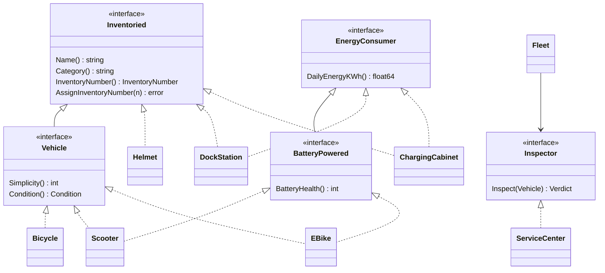

# ДЗ № 1

Консольное приложение учёта парка кикшеринга.
Транспорт попадает в парк только после техосмотра. 
Вещи (шлемы, док-станции, зарядные шкафы) ставятся на баланс без техосмотра. 
Всё, что стоит на балансе, получает сквозной инвентарный номер `ВК-000001`

Приложение умеет:


- выдавать отчёт по числу единиц (всего и по видам) и суточному энергопотреблению (транспорт, вещи, всего)
- показывать список транспорта для новичков
- печатать инвентарную ведомость

Зависимости собирает DI-контейнер [`go.uber.org/dig`](https://github.com/uber-go/dig).

## Запуск

Нужен Go 1.27.2+ (`go.mod`: `go 1.27.2`)

```bash
go run ./cmd/vyshkat # интерактивное меню
go run ./cmd/vyshkat -demo # демо-сценарий со всеми случаями

go test ./... # тесты
go test ./... -coverprofile=cover.out # покрытие
```

Демо-сценарий доступен в 6 пункте меню. Он показывает:
- исходные (пустые) отчёты
- приём техники и отказы техосмотра
- повторный приём
- некорректные данные
- вещи на балансе
- попытку поставить транспорт на баланс в обход техосмотра
- итоговые отчёты.

После демо парк заполнен, и отчёты можно смотреть вручную. Некорректный ввод в меню (буквы вместо чисел, значения вне диапазона, пустое имя) переспрашивается — это проверяют тесты `console/app_test.go`.

### Покрытие тестами

Покрытие считается штатным инструментом Go — `go test -cover`. Это покрытие **по операторам** (statement coverage): компилятор помечает каждый оператор, а процент — доля операторов, которые выполнились хотя бы раз за прогон тестов.

| Пакет | Покрытие |
|---|---|
| `internal/domain` | 100% |
| `internal/inspection` | 100% |
| `internal/catalog` | 100% |
| `internal/fleet` | ~97% |
| `internal/console` | ~92% |
| `internal/di` | 90% |
| `cmd/vyshkat` (только `main`) | 0% |
| **Итого по проекту** (`go tool cover -func`) | **~92%** |

Итог считается по всем операторам всех пакетов, включая непокрытый `main`. По умолчанию тесты пакета засчитывают покрытие только своему пакету. С флагом `-coverpkg=./...` засчитываются и вызовы в чужие пакеты итог при этом почти тот же. Непокрытыми остаются в основном ветки обрыва ввода (EOF) посреди диалога и защитные проверки, до которых при корректной работе не дойти. Ориентир ТЗ — ≥ 60%.

## Структура

```
cmd/vyshkat/main.go           точка входа
internal/domain/              доменная модель
  asset.go                      Inventoried, EnergyConsumer, InventoryNumber
  vehicle.go                    Vehicle, BatteryPowered, Condition, общие части транспорта
  transport.go                  Bicycle, Scooter, EBike
  items.go                      Helmet, DockStation, ChargingCabinet
  verdict.go                    Verdict
internal/inspection/          ServiceCenter - техосмотр
internal/fleet/               Fleet - приём, баланс, отчёты, интерфейс Inspector, BeginnerRule
internal/catalog/             реестр видов транспорта и вещей для консоли
internal/console/             меню, ввод с проверкой, отчёты, демо
internal/di/                  регистрация зависимостей в dig
```

## Модель 
(Попросил нейронку сделать схему)


## Ключевые решения

**Возможности задаются набором интерфейсов** Общий код собран из встраиваемых частей:
- `asset` содержит имя и номер
- `powered` содержит расход энергии
- `vehicle` содержит простоту и состояние
- `electric` содержит батарею.

Каждый конкретный тип собирает только нужные части. Шлем - это `asset`. Док-станция - `asset + powered`. Электросамокат - `vehicle + electric`. Поэтому шлем  не может отчитаться об энергии, а велосипед - о батарее.

Конструкторы (`NewScooter`, `NewDockStation` и др.) сначала проверяют параметры (`VehicleParams.validated`, `ElectricParams.validate`, `validName`, `validateEnergy`), а затем заполняют поля встроенных частей напрямую по продвинутым именам: `&Scooter{name: ..., simplicity: ..., dailyKWh: ...}`

**Инвентарный номер присваивает парк** в момент постановки на баланс (`Fleet.assignNumber`):
- номера сквозные для транспорта и вещей
- отклонённый техосмотром транспорт номера не получает
- повторно поставить объект на баланс нельзя.

**Отказ техосмотра - не ошибка.** `AcceptVehicle` возвращает `domain.Verdict` с перечнем причин. Через `error` возвращаются только нарушения учёта: повторный приём, `nil` и тп.

**Транспорт нельзя провести как вещь.** `Fleet.RegisterItem` отклоняет всё, что реализует `domain.Vehicle`

**Критерий простоты для новичка есть только у транспорта.**

**Энергия считается по всему балансу.** Док-станции и зарядные шкафы тоже потребляют энергию, и для оператора это часть энергопотребления парка

**Техосмотр проверяет** тормоза и раму у любого транспорта, а у электротранспорта ещё и остаточную ёмкость батареи

## Обязательные вопросы

### Какой принцип SOLID применён наиболее явно и где?

Модель построена на маленьких интерфейсах в `internal/domain/asset.go` и `internal/domain/vehicle.go`
- `Inventoried` реализует всё, что стоит на балансе
- `EnergyConsumer` - только то, что потребляет энергию
- `Vehicle` - только прокатный транспорт
- `BatteryPowered` - только электротранспорт.

Потребители спрашивают только то, что необходимо для конкретного объекта
- `Fleet.TotalDailyEnergyKWh` суммирует всё, что реализует `EnergyConsumer`, и ему не важно, самокат это или зарядный шкаф
- `ServiceCenter.Inspect` проверяет батарею только у `BatteryPowered`
- `Fleet.RegisterItem` отличает транспорт от вещей по `Vehicle`.

Шлему не приходится реализовывать «пустой» `DailyEnergyKWh() = 0`, а велосипеду — фиктивную батарею. Рядом так же явно применён DIP: `fleet.Inspector` в `internal/fleet/fleet.go`.

### Какой принцип сознательно ограничен и почему это приемлемо?

1. Парк одновременно хранит объекты, принимает их и строит отчёты (`Summary`, `BeginnerFriendly`, `TotalDailyEnergyKWh`). Отчёты стоило бы вынести в отдельный `ReportService`. Но все три отчёта - это короткие запросы к той же коллекции, и у них нет своей логики или зависимостей
2. `fleet.BeginnerRule` - это структура с порогом, а не интерфейс. Порог меняется конфигурацией (`di.Config`) без правки кода, а другой логики правила пока нет
3. `console.App` зависит от конкретного `*fleet.Fleet`. Это прикладной сервис в памяти с одной реализацией, и консоль тестируется вместе с ним на реальном сценарии ввода. Интерфейс понадобится, если появится второй источник данных

### Что сломается при расширении?

- **Сотрудник службы эксплуатации:** новый пакет со своей моделью и реестром. Сотрудник не реализует `Inventoried`, поэтому поставить его на баланс нельзя — `Fleet.RegisterItem` его просто не примет по типу, и это ловит компилятор

### Какие тесты фиксируют решение техосмотра и правило «для новичков»? Как подменяется зависимость?

- **Решение техосмотра** `internal/inspection/service_center_test.go`, `TestServiceCenterInspect`. Проверяет исправный транспорт, неисправные тормоза и раму, батарею ровно на пороге и ниже порога, а также несколько причин сразу
- **Как `Fleet` выполняет решение:**
  - `TestAcceptVehicle_Approved`: принят, получил номер, техосмотр вызван один раз.
  - `TestAcceptVehicle_Rejected`: не принят, номера нет, причины переданы.
  - `TestAcceptVehicle_Twice`: повторно на техосмотр не отправляется.
  - `TestRegisterItem_RejectsVehicle`: обход техосмотра запрещён.
  - Зависимость подменяется через конструктор: `fleet.New(&stubInspector{verdict: ...}, rule)`. `stubInspector` возвращает заданное решение и запоминает вызовы. `inspectorFunc` задаёт решение функцией.
- **Подмена через DI-контейнер:** `internal/di/container_test.go`. Собирается настоящий контейнер, затем `c.Decorate(func(fleet.Inspector) fleet.Inspector { return fake })` заменяет `ServiceCenter` на `fakeInspector` до создания `Fleet`.
  - `TestSubstituteInspector_Reject`: Подменный контейнер отклоняет исправный велосипед
  - `TestSubstituteInspector_Approve`: Подменный контейнер принимает самокат с изношенной батареей
- **Правило для новичков:**
  - `TestBeginnerFriendly`: граница 5/6 включительно
  - `TestBeginnerFriendly_CustomRule`: порог из конфигурации
  - `TestAcceptVehicle_Rejected`: отклонённый транспорт в список не попадает

Остальные тесты:
- `domain_test.go` - инварианты конструкторов, однократное присвоение номера и набор возможностей каждого типа
- `catalog_test.go` - каталог
- `console/app_test.go` - сценарии меню на строке ввода, включая повторный запрос при некорректном вводе и обрыв ввода
- `container_test.go` - сборка контейнера.